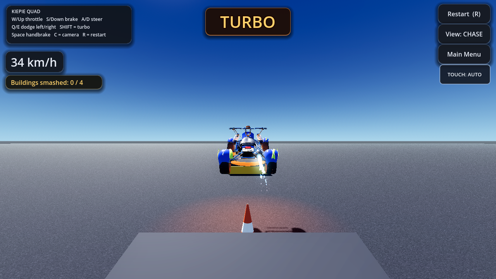
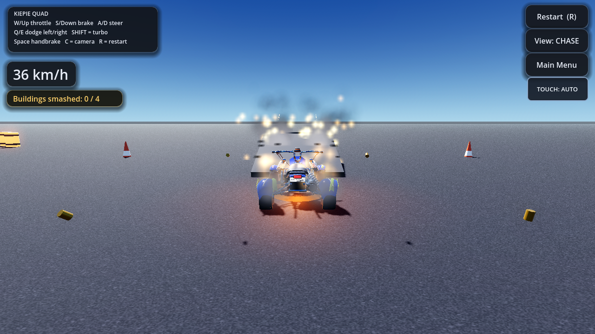

# Kiepie Quad — Web

Drive the Kiepie Bike (sport quad, Yamaha Blaster class) in your browser, or fight
other players in the combat arena. Built with Godot 4.3, exported to HTML/WASM,
hosted on Vercel and installable as a PWA.

▶ **Live: https://kiepie-quad-web.vercel.app** · mirror: **https://kiepie-bike.vercel.app**

## Modes

- **Practice** — the original free-ride pad: 3 ramps, a cone-ringed start line
  and 3 smashable buildings with a HUD smash counter.
- **Multiplayer** — Create Lobby / Join Auto / Join by code. `Join Auto` drops you
  into a waiting lobby (or creates one); the host starts the match and picks the
  kill target, rider cap, respawn delay, time limit and damage. First to the kill
  target wins. Multiplayer runs on a free Talo backend with host-authoritative scoring;
  builds without a game key fall back to an offline mock backend.

## Gameplay

Captured live from the practice track under the real renderer (WebGL2 via xvfb) with
[`godot/tools/screenshot_gameplay.gd`](godot/tools/screenshot_gameplay.gd) — not a gate, not retouched:






---

## Quick facts — controls

- `W` / `↑` — throttle (4WD)
- `A` / `D` (or `←` / `→`) — steering
- `S` / `↓` — brake, then reverse
- `Space` — handbrake
- `Shift` — **turbo** (hold while throttling): +30 % power, flames from the silencer
- `F` / left mouse — **fire both side cannons** in the arena (cooldown-gated)
- `C` — camera: chase ↔ free orbit (drag / scroll to zoom)
- `R` — reset to spawn (also the on-screen Restart button)
- On-screen touch overlay — **left analog** steer (push forward = turbo, pull back =
  brake/reverse) and **right analog** drive (rest finger = gas, push up = fire,
  push left/right = dodge cartwheel). No auto-fire: cannons fire only on the
  up-gesture. Auto-appears on touch devices; the **TOUCH** button force-shows/hides it anywhere.

## Combat

Each rider has 100 armour; a kill explodes the bike and respawns it at a random
point after the lobby's respawn delay. The shooter gets the point. The arena has
cover, ramps, destructible buildings, a radar, a scoreboard and a kill feed.

Pickups spawn around the arena: **shield** (temporary invulnerability), **rapid**
(faster cannons), **repair** (+45 armour) and **overdrive** (more power). Red fuel
drums explode when shot and chain-detonate nearby drums. Expect camera shake,
hit-stop, damage numbers, tyre smoke, scorch marks and a full sound pack.

## Mobile / settings

Responsive landscape layout with safe-area support. Settings (persisted on your
device) cover quality presets for slower phones, audio, controls (including dodge
button size, steering sensitivity and touch force), display name/colour and a diagnostics overlay. Use **Restore
Defaults** to reset.

## Notes

- Requires WebGL2 / a modern browser. Chrome, Firefox and Edge recommended.
- Personal, non-commercial interactive model showcase of a Blaster-class sport quad.
- Vehicle is raycast-suspension (4 × VehicleWheel3D) — for games, not for racing lines.
- A scoped Talo **game** key is embedded in the public Web build by design; it is not a
  secret. Never reuse an admin key or any credential with write access to other services.

## Repository
This is the single repository for the Kiepie Quad project: the Blender/Godot **source** at the repo root, and the **Web build** (`index.html` / `index.wasm` / `index.pck` …) served from the repository root by Vercel. `SOURCE.md` carries the original source/QA documentation. `web/` (the export staging folder) is git-ignored so export artifacts never enter the repo unverified.

## Documentation

- **[docs/index.md](docs/index.md)** — navigation hub for all docs.
- **[docs/project-plan.md](docs/project-plan.md)** — canonical project plan, architecture pointers and the single canonical constants table.
- **[docs/task-status.md](docs/task-status.md)** — done-vs-pending ledger: the 2026-11-18 10-principal-engineer audit remediation per finding (commits `1494b0d`, `60a8b82`, deploy `f09c80e`), blocked items and deferred work.
- **[docs/audits/](docs/audits/)** — audit source reports.
---

Controls:

| Key | Action |
| --- | --- |
| `W` / `↑` | Throttle (4-wheel drive) |
| `S` / `↓` | Brake → reverse |
| `A` / `D` (or `←`/`→`) | Steer |
| `Space` | Handbrake |
| `Shift` | **Turbo** — hold while throttling: +30 % power, flames from the silencer, "TURBO" flash on the HUD |
| `C` | Camera — chase ↔ free orbit (drag mouse / wheel to zoom) |
| `Q` / `E` | Dodge left / right — lateral leap + cartwheel to evade attacks (ground-only, 1 s cooldown) |
| `R` | Reset to spawn (also the on-screen **Restart** button) |
| Touch | Two analog pads auto-appear on touch devices. **Left**: steer, push forward for **turbo**, pull back to brake/reverse. **Right**: rest a finger for **gas**, push **up** to **fire** (manual, cooldown-gated — no auto-fire), push **left/right** for the **dodge** cartwheel. The **TOUCH** button (top-right) force-shows/hides them. Dodge pad size, steering sensitivity and touch force are adjustable in Settings → Controls |

`TestRide.tscn` is the playable practice pad: asphalt, cone ring, start line, six **ramps**
(including a cone-clearing jump line with a landing slope), four **smashable buildings**
(drive into them at speed — they burst into debris and an on-screen counter tracks it),
a follow camera, working **practice cannons** (F / left mouse on desktop,
right-analog up on mobile — no lobby required, no
network kill broadcasts) and a HUD with speed readout, smash counter,
turbo indicator and Restart / View buttons. Rollover immunity (lowered center of
mass + angular lockout + righting spring) — the quad cannot flip. It is a placeholder — build your real
track in it or as a sibling scene.

### Wiring the bike into your own track

1. Build your track into a scene.
2. Instance `scenes/KiepieBike.tscn`.
3. Give the track `StaticBody3D` colliders (your track meshes) — the wheels are raycasts,
   so they grip any physics surface.
4. For custom sound/HUD/AI, edit `godot/src/KiepieBike.gd` (throttle, brake, steering) and
   `godot/src/FollowCam.gd` (chase camera).

### How the bike is wired for driving

`scenes/KiepieBike.tscn` is a `VehicleBody3D`:

- **Model:** instanced GLB — `Model/Bike_Root/...`, materials preserved.
- **Wheels:** `VehicleWheel3D` node per wheel (`WheelFL`…`WheelRR`), positioned on the real
  axle lines; front pair steers, all four drive.
- **Visual steering:** `Model/Steer_FL` / `Model/Steer_FR` pivots yaw the front wheel
  meshes; `Model/Wheel_*` meshes roll about their axle.
- **Suspension & stability:** raycast suspension tuned for a 185 kg quad; center of mass pulled down + angular lockout + righting spring — rollover impossible (verified: up.y stays 1.0000 through full-throttle weaving and exits the building smash at 0.998).
- **Decals:** image-textured quads, not geometry text.

Physics is verified headless: `godot-4.3 --headless --path godot --script tools/truth_test.gd` — settles on its tyres and accelerates 0 → 9.5 m/s in 5 s; `tools/verify_features.gd`, `tools/verify_stability.gd` and `tools/verify_smash_impact.gd` cover turbo, camera, rollover immunity and smash.

---

## Rebuilding the bike from source

Requirements: Blender 5.3 (`/snap/bin/blender`) or a Blender 5.3 with the MCP add-on;
Python 3.11+ for the venv helper you choose.

```bash
blender -b -noaudio -P src/build_quad.py           # rebuild, .blend, .glb and preview renders
blender -b -noaudio -P src/repair_and_verify.py    # full pipeline: .blend, .glb, .stl, round-trip verify
```

- `src/qb_spec.py` — every master dimension (tyre radius, rim radius, axle heights…)
- `src/qb_wheels.py` — tyres (knobby block tread), rims, beadlock rings, brakes, suspension
- `src/qb_body.py` — frame, fenders, seat, lights, controls, image-textured decals
- `src/qb_engine.py` — engine, cylinder + fins, CVT, belt, sprocket, exhaust, radiator
- `src/qb_core.py`  — scene purge, materials, mesh builders, decal-plane helper
- `src/build_quad.py` — assembly, studio lighting/camera, export, previews

To change a dimension: edit `qb_spec.py`, re-run, re-export.

---

## Model integrity / QA

Run through the `surgical-building` QA reviewer (headless Blender, `-b -noaudio`):

```
status: APPROVED
non_manifold_edges: 0
measured_bounds: 1.477 m (w) × 2.144 m (d) × 1.077 m (h)   (slim photo-matched fenders)
ground datum: minZ = 0.000 m (gate |minZ| ≤ 0.005 m)
payload_sha256: 14475f6dfd44e5e315126ff7342813681588c56526278863102ada896bc48f40
```

Every mesh is a closed (watertight) 2-manifold. The QA STL has ~22 k vertices / ~44 k triangles.

Re-run it yourself:

```bash
blender -b -noaudio -P /home/leandi-duplessis/.config/opencode/skills/surgical-building/scripts/blender_qa_reviewer.py -- \
  Kiepie_Bike.stl spatial_manifest.json QA_debrief_stl.json
```

Diagnostics: `QA_debrief_stl_front_0.png`, `…_right_90.png`, `…_top_ortho.png`, `…_iso_45.png`.

---

## Accuracy — where it's solid, where it's approximate

**Solid (anchored to the photos / object class):**

- Rim / tyre ratio measured from both photos ≈ **0.55** → 12 in rims, **22 in** tyres, both axles
- Tyre geometry: tall sidewalls, staggered block tread, shoulder lugs
- Silhouette, stance, fender arcs, handlebar sweep, seat shape — visually verified against both photos
- Beadlock bolt-ring count and wheel material match the reference (dark steel + alloy ring)

**Approximate:**

- Absolute dimensions are **class-anchored, not photogrammetrically triangulated** —
  the two photos are oblique 3/4 views, insufficient for SfM reconstruction. The photos were not
  shot for measurement. Treat overall length/width/height and wheelbase as **≈ ±5–10 %**.
- Engine internals (cam cover, carb position, intake routing) are stylized, not a copy of the
  real part-number assembly; the real Blaster's cylinder leans forward and intake snorkel rises
  on the right side — both are represented, though not to factory dimensions.
- Decals are original-ish graphics approximating the reference photos; they are not the
  manufacturer's actual trade dress.
- Suspension travel/spring rate are tuned for driving feel, not measured from the photo.

If you want metrology-grade reference, you need a 3/4 set of orthographic-elevation photos, or a
turntable video — the current photos can't give it.

---

## Development

```bash
bash godot/tools/run_gates.sh              # rebuild all scenes + all headless gates + GdUnit4
bash godot/tools/run_gates.sh --no-build   # reuse generated scenes

# Compile-check scripts inside a real project run (autoload-aware):
godot-4.3 --headless --path godot -s tools/_check_scripts.gd
```

`gdlint` / `gdtoolkit` are not installed here — do not rely on them. `godot-4.3 --check-only`
also reports false "Identifier not found" errors for autoloads; use `_check_scripts.gd`.

GdUnit4 v5.1.1 (Godot 4.3-compatible) unit tests live in `godot/tests/`.
See `AGENTS.md` for toolchain details and exporter gotchas.

## Known limitations / roadmap

- Front suspension is fixed; steering rotates the wheel meshes only (no tie-rod articulation).
- No rider, no saddle animation, no swingarm animation (engine-loop audio ships in the sound pack).
- Buildings restack as static decor — demolition is once per run (no respawn).
- No factory Yamaha dimensions were used (none were provided); everything stays within
  ±10 % of the photos.
- Draco `.glb` exports retain normal-buffer sizes to stay cheap; re-baking texture compression
  (KHR_texture_basisu) would shrink further.
- The STL QA export removes ~24 degenerate triangles on import (an STL artifact; the
  `.blend` itself is clean — 0 non-manifold edges).

---

## Editing the bike

- **Materials:** all on the `Paint_*` / `Engine_*` / `Chrome` / `Matte` / `Tyre_*` nodes in
  `src/qb_core.py`.
- **Pivots:** wheels roll on `Model/Wheel_*` about local X; steering yaws `Model/Steer_FL`,
  `Model/Steer_FR` about local Y. Do not parent them to each other — parent them to
  `Model/Bike_Root` (or `KiepieBike`).
- **Decals:** image quads (`Decal_BLASTER_*`, `Decal_GAMING_*`). Swap in `assets/decal_*.png`
  and re-export.

---

## Trademarks / licence

`BLASTER`, `GAMING` and the Yamaha motorcycle/ATV trade dress belong to Yamaha Motor Co., Ltd.
This asset is for **private / portfolio** use and as a placeholder for your own branded vehicle.
Do not distribute commercially without replacing the decals and renaming the vehicle.

---

## File map

```
kiepie-quad-web/               # repo root = project root + Vercel-served Web build at root

├─ Kiepie_Bike.blend        # Blender scene (bike + studio)
├─ Kiepie_Bike.glb          # glTF 2.0, ready for engines (~1.50 MB)
├─ Kiepie_Bike_draco.glb    # Draco-compressed (~0.48 MB)
├─ Kiepie_Bike.stl          # for QA / 3D-print proofing (~2.2 MB)
├─ spatial_manifest.json    # QA manifest
├─ QA_debrief_stl.json      # QA reviewer verdict (APPROVED)
├─ assets/                  # decal textures baked into the export
├─ src/                     # Python build scripts (bpy)
├─ godot/                   # Godot 4.3 project (open this to drive it)
│  ├─ scenes/               # generated by tools/build_*.gd — never hand-edit
│  │  ├─ MainMenu.tscn      # boot scene
│  │  ├─ LobbyMenu.tscn, SettingsMenu.tscn, Arena.tscn
│  │  └─ TestRide.tscn, KiepieBike.tscn
│  ├─ src/                  # gameplay GDScript (core/, game/, net/, audio/, ui/)
│  └─ tools/                # scene builders + gates + GdUnit4
└─ renders/                 # all preview renders
```

---

Built procedurally with Blender 5.3 + Godot 4.3. Rebuilt from scratch on every release.

---

## Multiplayer combat + mobile Web (new)

The game now boots into a **Main Menu** with `Practice` (the original free-ride/smash track),
`Create Lobby`, `Join Auto`, `Join by code` and `Settings`. `Join Auto` finds a waiting lobby
with a free slot and creates one if none exists.

**Combat:** the Blender-authored twin side cannons fire with **F / left mouse** on desktop,
and the **right analog pushed up** on mobile (left pad push-forward is turbo). Each bike has 100
armour; the host-configured damage default is 30 per hit; cannons fire on a short cooldown, and
a destroyed bike explodes and respawns at a random spawn point after the lobby's respawn delay.
The shooter scores the kill; first to the lobby's kill target wins.
The arena (~100 m) has cover, ten ramps (two designed gap-jump lines plus two cover hops),
seven destructible buildings, an outside-the-walls venue silhouette with floodlights, a radar
and an off-screen-free scoreboard/kill feed.

**Backend:** **Talo** (Supabase/Convex were dropped). A free Talo game key is injected at build
time from `TALO_API_GAME` in the repo-root `.env` via `godot/tools/inject_talo_key.py`; the
deploy helper does this automatically. The Web build ships that key inside the public pck by
design — use a disposable, scoped dev key, never `TALO_API_ADMIN`. Lobbies are Talo channels,
state lives in host-owned channel props, and shots/kills flow over channel socket messages.
Scoring is host-authoritative client logic (no server-side validation). Lobbies are stamped with a
`protocol_version` channel prop — clients on a different wire version never get mixed in
(`join_auto` skips the channel; `join_by_code` reports a version error). Without a key the client
uses a full offline `MockBackend`, so all 25 gates run without credentials. The old `supabase/`
migrations are retained for history only and are not deployed.

**VFX pass:** effects are built by `godot/src/game/VfxFactory.gd` from five tiny sprites
generated once at runtime (soft puff, spark streak, flare star, ground ring, noise smoke),
so the Web pck does not grow. Explosions are staged (core flash → fireball → ember streaks →
rising smoke, with cooling debris and a soft scorch), shots that hit scenery leave sparks and
fading scars, and building smashes combine a glass flash, ground dust wave and staggered
collapse puffs. Ramp landings and fast cornering kick up dust; shields, pickups and landed
hits all have their own read. Everything scales with the particle-quality setting and
collapses to static cues under reduced motion. Decal counts are capped so long fights cannot
leak nodes. The three extra facades are deterministic: re-run
`python3 godot/tools/gen_arena_textures.py` and `godot-4.3 --headless --path godot --import`
after changing them.

**Appeal pass:** 8 rotating pickups (shield / rapid-fire / repair / overdrive), 10
chain-exploding fuel drums, a full procedurally synthesised sound pack (cannon,
impacts, explosion, pickups, turbo, kill sting, engine loop), camera shake and
recoil, 60 ms hit-stop on kills, kill-cam spectating of your killer, floating
damage numbers, hurt vignette, tyre smoke, scorch decals, coloured underglow on
every bike, streak callouts ("RAMPAGE x3") and host-authoritative match time limits.

**Mobile Web:** responsive landscape layout, safe-area-aware HTML shell, installable PWA,
real two-thumb multi-touch (gas/boost/steer work simultaneously via per-finger input
tracking — not the single emulated mouse pointer) and an analog steering pad feeding
proportional steer strength, large touch controls and quality presets
(low/medium/high) that scale particles, shadows and resolution. Settings persist in
`user://settings.cfg` and can be restored to defaults.

**New gates:** `verify_cannons.gd`, `verify_settings.gd`, `verify_match_rules.gd`,
`verify_combat.gd`, `verify_kill_flow.gd`, `verify_appeal.gd`, `verify_talo_backend.gd` and
`verify_audit_regressions.gd`, `verify_controls.gd`, `verify_dodge.gd` and `verify_rollover.gd` join the existing
suite — `godot/tools/run_gates.sh` now runs 25 gates offline (22 headless gates plus GdUnit4,
the `scene_sync` drift check and one xvfb-windowed multi-touch gate, `verify_touch_multitouch.gd`).
The new `verify_practice.gd` locks practice-mode cannons (no lobby required, desktop
hold-to-fire + mobile right-analog-up manual firing (no auto-fire), real input-driven projectile spawn).
The new `verify_vfx.gd` locks effect contracts (reduced motion, quality scaling, decal caps,
flat-normal safety) and the new arena/test-track ramp and building counts with spawn clearance.
The new gates exercise `TaloBackend` directly with no live account, lock the surgical-audit
regressions (forged state, VFX gradient stops, exhaust axis, malformed shot payloads, respawn
deadline), prove that steering actually yaws the bike while keeping it upright, and lock the
Q/E dodge (direction, lift, cooldown, recovery). `godot/tools/deploy_web.sh` runs the gates, exports, checks the bundle,
then (with `--apply`) commits, pushes and deploys to Vercel.
`xvfb-run -a godot-4.3 --path godot --script tools/vfx_showcase.gd` re-renders five VFX/layout
proof images into `renders/` under the real Web renderer (not a gate), and
`KIEPIE_MOCK_BACKEND=1 xvfb-run -a -s "-screen 0 1280x720x24" godot-4.3 --resolution 1280x720 --path godot --script tools/screenshot_gameplay.gd` re-renders the three gameplay shots above.

**Audit hardening (2026-11-18):** the 10-principal-engineer audit
([docs/audits/](docs/audits/)) was remediated in `1494b0d` + `60a8b82` — deploy-script
locking and branch assertions, PWA double-WASM-download fix, serialized center of mass,
frame-rate-invariant rollover damping, transitions-only match events, touch-emulation
fire fixes, host-leave/join/reconnect handshakes, monotonic relay ticks and VFX content
caching. Per-finding evidence and the remaining deferred items:
[docs/task-status.md](docs/task-status.md).

Web export produces `web/index.pck` (~2.7 MB; the bundle check aborts above 4 MB) plus PWA
manifest/service worker. `web/` is a git-ignored staging folder; `godot/tools/deploy_web.sh --apply`
syncs the bundle into the repo root, commits `index.*` and pushes `main` — **pushes to `main`
auto-deploy to Vercel** (verified 2026-11-18, ~5 s per production deploy). The gate suite also
runs on every PR via `.github/workflows/gates.yml`.

The web shell carries a **themed loading surface**: `web-assets/dashboard_bg.jpg` (navy quad
ghost + grid, behind the progress bar) and `web-assets/kiepie-quad-splash.mp4` (8 s, 1280x720,
1.9 MB — Blender hero plates of the KIEPIE QUAD + kinetic HUD + pad/whoosh audio, rendered via
the `surgical-media` pipeline). The splash autoplays **muted**, is skippable by click/touch,
`Esc`, or when the clip ends; returning visitors skip it via `localStorage`
(`kiepie_splash_seen_v1`), and `prefers-reduced-motion` removes it instantly. The same markup
is embedded in `html/head_include` so a re-export reproduces it; root `index.html` ships it
directly. `web-assets/` lives outside `godot/` so the pck stays ~2.7 MB. `index.png` is the
themed 1200x900 (4:3) loading card (replacing the default Godot logo).
