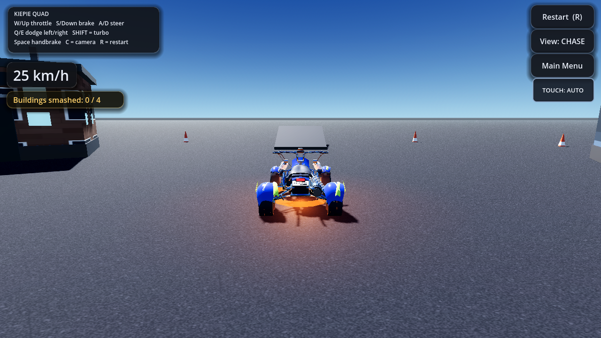
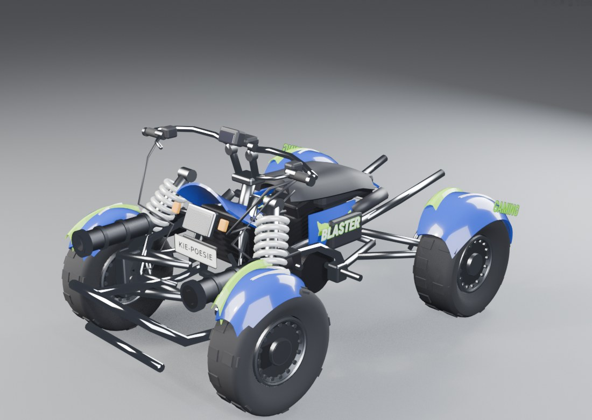
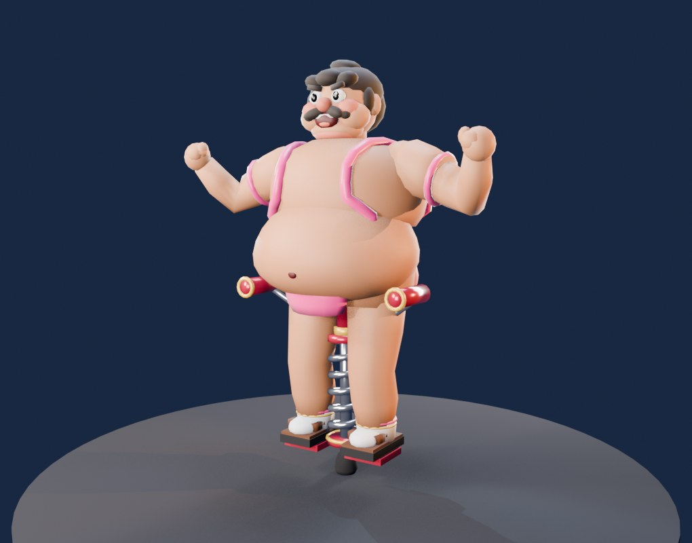
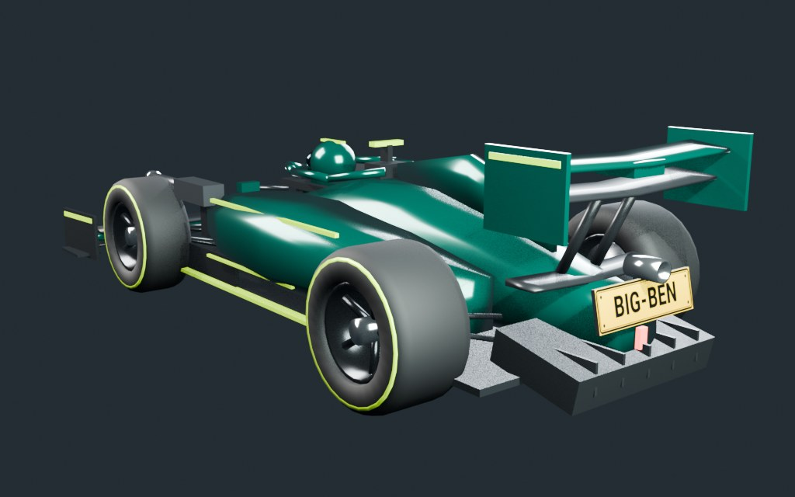
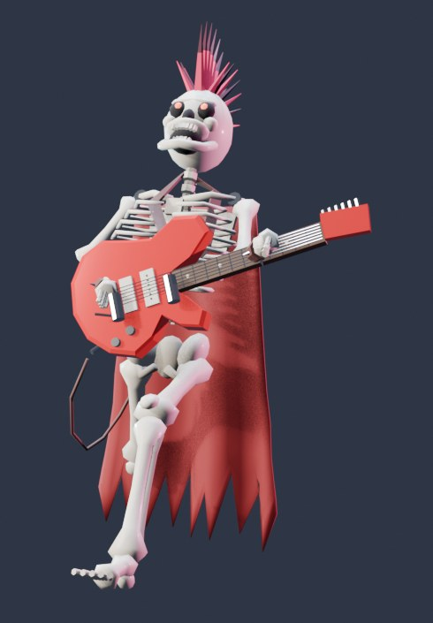
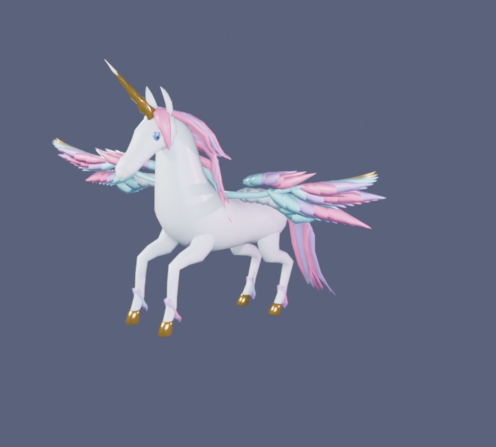

# Kiepie Quad — Web

Drive a sport quad, pogo brawler, F1 car or something weirder in your browser, or
fight other players in the combat arena. **Five vehicles** (Kiepie QUAD — sport
quad, Yamaha Blaster class — NARDUS, BIG-BEN F1, EVAN THE SKELETON, LEA UNICORN),
each with its own 3-weapon kit. Built with Godot 4.3, exported to HTML/WASM,
hosted on Vercel and installable as a PWA.

▶ **Live: https://kiepie-quad-web.vercel.app**

## Modes

- **Battle Royale (Default)** — 100×100 m multiplayer combat arena (plus **Practice** free-ride pad with ramps and smashable buildings). Create Lobby / Join Auto / Join by code; first rider to reach the elimination target wins.
- **Death Race** — high-speed closed-circuit combat racetrack (`DeathRace.tscn`) featuring sweeping banked turns, 2 full 360° vertical stunt loops, 3 molten hazard pits, a pit stop service lane, 8 jump ramps, pickups, 4 ordered checkpoints, and a checkered Start/Finish Line gantry tracking laps. First racer to complete the target laps triggers the **Victory Splash video** (`web-assets/kiepie-victory-splash.mp4`) and wins.
- **Arsenal (Both Modes & Practice)** — every vehicle carries a **3-weapon kit** in three slots (`primary` / `rocket` / `meteor` wire kinds); cycle by pulling the **right analog stick back** on mobile (or pressing `Tab` / `V`, or `1` / `2` / `3` on desktop), with a live **HUD Reload Bar** + weapon label showing reload status. Base hit = host-configured `Match.damage()` (default `30`, clamped `10–100`; **NARDUS `2×`**); **both barrels fire per shot**. Wire protocol unchanged (`protocol_version` `3`).

  | Slot | Cooldown | **Kiepie QUAD** | **NARDUS** | **BIG-BEN F1** | **EVAN THE SKELETON** | **LEA UNICORN** |
  | --- | --- | --- | --- | --- | --- | --- |
  | **Primary** | `0.20 s` (`0.09 s` rapid); NARDUS `0.40 s`/`0.18 s`; EVAN `0.22 s`/`0.10 s`; LEA `0.16 s`/`0.08 s` | **MACHINE GUN** (bolt, 30 dmg) | **BANANA CANNON** (dual bananas, 60 dmg, `pop` SFX) | **F1 AUTOCANNON** | **RIFF BLASTER** (hot-pink sound waves) | **HORN RAPID FIRE** (golden horn sparks) |
  | **Rocket** | `1.5 s` | **ROCKET LAUNCHER** (finned rocket) | **CIGAR LAUNCHER** (massive cigar) | **CASH BAG LAUNCHER** (cash bag) | **BOOMERANG GUITAR** (frisbee-spinning double-cutaway, 3-ray blade sweep, out-and-return, early-catch cooldown refund) | **HORN BEAM** (`0.55 s` vortex charge → `0.35 s` straight plasma beam, up to `8` targets in line, `55 m`) |
  | **Special** | `6.0 s`, `2.0 s` telegraph, `7.5 m` zone | **LIGHTNING STRIKE** | **METEOR SHOWER** (flaming meteor from sky) | **CASH BAG DROP** (cash bag from sky) | **DEVIL HAND** (clawed hand erupts, drags victims underground, **instant kill**) | **UNICORN BOOM** (wing-spread sky leap + supernova touchdown, **instant kill**) |

  - **Rocket slot (all vehicles):** fires once every **1.5 s**; a **direct hit is an instant kill** (ignores shield + spawn invulnerability); anything else inside the **4.5 m** blast radius takes **flat `90` damage** (`Match.damage()` does not scale rockets). Direct-hit lethality is **victim-authority** (`CombatController`); see Known limitations.
  - **Special slot (all vehicles):** single AOE on a ground-raycast target (`12–44 m` aim, reticle shown); **`105` center damage** (`Match.damage() × 3.5`) across **`7.5 m`** after a **`2.0 s`** sky-fall/telegraph — **except** EVAN's **DEVIL HAND** and LEA's **UNICORN BOOM**, which are **instant-kill** zones (`CombatAoe.apply_lethal_blast`, fail-closed victim authority; the kill is unconditional inside `7.5 m`).

## Gameplay

Captured live from the practice track under the real renderer (WebGL2 via xvfb) with
[`godot/tools/screenshot_gameplay.gd`](godot/tools/screenshot_gameplay.gd) — not a gate, not retouched:




---

## Vehicles

**Five vehicles.** Pick your preferred ride in `MainMenu` (`VehicleSelect`, persisted in Settings `gameplay/vehicle`, synced through the lobby row) or leave it on **AUTO (DEAL)** for a deterministic FNV-1a-32 hash draw. The AUTO pool is **three vehicles** (Kiepie QUAD / NARDUS / BIG-BEN F1); **NARDUS is guaranteed to at least one player** in every match (`VehicleRegistry.for_player_in_roster`). **EVAN THE SKELETON** and **LEA UNICORN** are **preference-only encores**: selectable and synced, deliberately excluded from AUTO (DEAL) so the deterministic hash never shifts. All five share the same vehicle handling, armour and Q/E cartwheel dodge; each keeps its own visual shell, rig and three-slot weapon kit. Weapon damage and cooldowns are listed in **Arsenal** above.

### Kiepie QUAD — photo-anchored sport quad



**Layout:** open steel-tube chassis, blue fenders, four 22-inch knobby tyres on 12-inch beadlock rims, twin side cannons and image-textured decals. The left and right muzzle anchors sit on the cannon bores. **Motion:** wheel roll and front steering; the shared ground-only Q/E dodge is a lateral leap and cartwheel. **Three-slot kit:** Machine Gun → finned Rocket Launcher → **Lightning Strike** ground-targeted AOE.

### NARDUS — spring-loaded pogo brawler



**Layout:** articulated rider pivots above a telescoping stick and live-compression spring; gold NARDUS back print, pink mankini and banana muzzles complete the silhouette. **Motion:** procedural hop, spring compression, landing slam and turbo bird-wing flap. **Three-slot kit:** dual Banana Cannon → oversized Cigar Launcher → **Meteor Shower**. NARDUS deals twice the primary damage while keeping the shared vehicle handling.

### BIG-BEN F1 — low-slung single-seater



**Layout:** dark green F1 body, front and rear wings, wide tyres, steerable front wheel pivots, `BIG-BEN` rear plate and `Exhaust_Tip`. The body shell is raised 6 cm over the wheels to preserve diffuser clearance. **Motion:** front wheels steer and all four wheels roll. **Three-slot kit:** F1 Autocannon → Cash Bag Launcher → **Cash Bag Drop**.

### EVAN THE SKELETON — on-foot guitarist



**Layout:** 52-joint anatomical skeleton with a two-tone mohawk, laughing skull, double-cutaway hot-pink guitar, leather strap and trailing cable; Evan runs on foot without a visible quad chassis. **Motion:** seven baked clips drive the stride, turbo headbang, leap, guitar throw and catch, with sub-stepped landing and sprint response. **Three-slot kit:** Riff Blaster sound waves → returning Boomerang Guitar → **Devil Hand**, a ground-erupting claw strike with an instant-kill zone.

### LEA UNICORN — pearl-coated winged equine



**Layout:** 52-joint winged equine with a pearl coat, bright blue eyes, spiral gold horn, flowing pink/lavender/cyan mane and a layered 39-feather fan on each wing. Wings fold along the back at rest and spread for flight. **Motion:** speed-coupled gallop, reverse backpedal, charge wing-spread and UnicornBoom flight. **Three-slot kit:** golden Horn Rapid Fire → charged Horn Beam → **Unicorn Boom**, a wing-spread leap and supernova touchdown with an instant-kill zone.

## Quick facts — controls

- `W` / `↑` — throttle (4WD)
- `A` / `D` (or `←` / `→`) — steering
- `S` / `↓` — brake, then reverse
- `Space` — handbrake
- `Shift` — **turbo** (hold while throttling): +24 % engine power & higher top speed (28→33 m/s cap; OVERDRIVE → 1.38× / 36 m/s), flames from the silencer
- `F` / left mouse — **fire your primary weapon** in the arena (cooldown-gated; `Tab`/`V`/`1–3` cycle your 3-weapon kit)
- `C` — camera: chase ↔ free orbit (drag / scroll to zoom)
- `R` — reset to spawn (also the on-screen Restart button)
- On-screen touch overlay — **left analog** steer (push forward = turbo, pull back =
  brake/reverse) and **right analog** drive (rest finger = gas, push up = fire,
  push left/right = dodge cartwheel). No auto-fire: cannons fire only on the
  up-gesture. Auto-appears on touch devices; the **TOUCH** button force-shows/hides it anywhere.

## Combat

Each rider has 100 armour; a kill explodes the bike and respawns it at a random
point after the lobby's respawn delay. The shooter gets the point. The arena has
cover, ramps, destructible buildings, a radar, a scoreboard and a kill feed.

**8 pickups** spawn around the arena (2 of each): **shield** (`4 s`
invulnerability), **rapid** (`8 s` faster cannons at each vehicle's rapid
cooldown: `0.09 s` QUAD/F1, `0.18 s` NARDUS, `0.10 s` EVAN, `0.08 s` LEA), **repair** (+45 armour, capped at 100) and **overdrive** (`8 s`:
counts as turbo, `1.38×` power, `36 m/s` top-speed cap). Red fuel
drums explode when shot and chain-detonate nearby drums. Expect camera shake,
hit-stop, damage numbers, tyre smoke, scorch marks and a full sound pack.

## Mobile / settings

Responsive landscape layout with safe-area support. Settings (persisted on your
device) cover quality presets for slower phones, audio, controls (including dodge
button size, steering sensitivity and touch force), display name/colour and a diagnostics overlay. Use **Restore
Defaults** to reset.

## Notes

- Requires WebGL2 / a modern browser. Chrome, Firefox and Edge recommended.
- Before commercial release, replace the Yamaha-marked `BLASTER` / `GAMING` quad decals in `assets/decal_blaster.png` and `assets/decal_gaming.png`; the other vehicle and character names shown here are project designs.
- Vehicle is raycast-suspension (4 × VehicleWheel3D) — for games, not for racing lines.
- A scoped Talo **game** key is embedded in the public Web build by design; it is not a
  secret. Never reuse an admin key or any credential with write access to other services.

## Repository
This is the single repository for the Kiepie Quad project: the Blender/Godot **source** at the repo root, and the **Web build** (`index.html` / `index.wasm` / `index.pck` …) served from the repository root by Vercel. `SOURCE.md` carries the original source/QA documentation. `web/` (the export staging folder) is git-ignored so export artifacts never enter the repo unverified.

## Documentation

- **[docs/index.md](docs/index.md)** — navigation hub for all docs.
- **[docs/project-plan.md](docs/project-plan.md)** — canonical project plan, architecture pointers and the single canonical constants table.
- **[docs/task-status.md](docs/task-status.md)** — done-vs-pending ledger: the 2026-11-18 10-principal-engineer audit remediation per finding (commits `1494b0d`, `60a8b82`, deploy `f09c80e`), blocked items and deferred work.
- **[docs/audits/](docs/audits/)** — audit source reports.
---

Controls:

| Key | Action |
| --- | --- |
| `W` / `↑` | Throttle (4-wheel drive) |
| `S` / `↓` | Brake → reverse |
| `A` / `D` (or `←`/`→`) | Steer |
| `Space` | Handbrake |
| `Shift` | **Turbo** — hold while throttling: +24 % engine power & higher top speed (28→33 m/s cap), flames from the silencer, "TURBO" flash on the HUD |
| `C` | Camera — chase ↔ free orbit (drag mouse / wheel to zoom) |
| `Q` / `E` | Dodge left / right — lateral leap + cartwheel to evade attacks (ground-only, 1 s cooldown) |
| `R` | Reset to spawn (also the on-screen **Restart** button) |
| Touch | Two analog pads auto-appear on touch devices. **Left**: steer, push forward for **turbo**, pull back to brake/reverse. **Right**: rest a finger for **gas**, push **up** to **fire** (manual, cooldown-gated — no auto-fire), push **left/right** for the **dodge** cartwheel. The **TOUCH** button (top-right) force-shows/hides them. Dodge pad size, steering sensitivity and touch force are adjustable in Settings → Controls |

`TestRide.tscn` is the playable practice pad: asphalt, cone ring, start line, six **ramps**
(including a cone-clearing jump line with a landing slope), four **smashable buildings**
(drive into them at speed — they burst into debris and an on-screen counter tracks it),
a follow camera, working **practice cannons** (F / left mouse on desktop,
right-analog up on mobile — no lobby required, no
network kill broadcasts) and a HUD with speed readout, smash counter,
turbo indicator and Restart / View buttons. Rollover immunity (lowered center of
mass + angular lockout + righting spring) — the quad cannot flip. It is a placeholder — build your real
track in it or as a sibling scene.

### Wiring the bike into your own track

1. Build your track into a scene.
2. Instance `scenes/KiepieBike.tscn`.
3. Give the track `StaticBody3D` colliders (your track meshes) — the wheels are raycasts,
   so they grip any physics surface.
4. For custom sound/HUD/AI, edit `godot/src/KiepieBike.gd` (throttle, brake, steering) and
   `godot/src/FollowCam.gd` (chase camera).

### How the bike is wired for driving

`scenes/KiepieBike.tscn` is a `VehicleBody3D`:

- **Model:** instanced GLB — `Model/Bike_Root/...`, materials preserved.
- **Wheels:** `VehicleWheel3D` node per wheel (`WheelFL`…`WheelRR`), positioned on the real
  axle lines; front pair steers, all four drive.
- **Visual steering:** `Model/Steer_FL` / `Model/Steer_FR` pivots yaw the front wheel
  meshes; `Model/Wheel_*` meshes roll about their axle.
- **Suspension & stability:** raycast suspension tuned for a 185 kg quad; center of mass pulled down + angular lockout + righting spring — rollover impossible (verified: up.y stays 1.0000 through full-throttle weaving and exits the building smash at 0.998).
- **Decals:** image-textured quads, not geometry text.

Physics is verified headless: `godot-4.3 --headless --path godot --script tools/truth_test.gd` — settles on its tyres and accelerates 0 → 9.5 m/s in 5 s; `tools/verify_features.gd`, `tools/verify_stability.gd` and `tools/verify_smash_impact.gd` cover turbo, camera, rollover immunity and smash.

---

## Rebuilding the bike from source

Requirements: Blender 5.3 (`/snap/bin/blender`) or a Blender 5.3 with the MCP add-on;
Python 3.11+ for the venv helper you choose.

```bash
blender -b -noaudio -P src/build_quad.py           # rebuild, .blend, .glb and preview renders
blender -b -noaudio -P src/repair_and_verify.py    # full pipeline: .blend, .glb, .stl, round-trip verify
```

- `src/qb_spec.py` — every master dimension (tyre radius, rim radius, axle heights…)
- `src/qb_wheels.py` — tyres (knobby block tread), rims, beadlock rings, brakes, suspension
- `src/qb_body.py` — frame, fenders, seat, lights, controls, image-textured decals
- `src/qb_engine.py` — engine, cylinder + fins, CVT, belt, sprocket, exhaust, radiator
- `src/qb_core.py`  — scene purge, materials, mesh builders, decal-plane helper
- `src/build_quad.py` — assembly, studio lighting/camera, export, previews

To change a dimension: edit `qb_spec.py`, re-run, re-export.

---

## Model integrity / QA

Run through the `surgical-building` QA reviewer (headless Blender, `-b -noaudio`):

```
status: APPROVED
non_manifold_edges: 0
measured_bounds: 1.477 m (w) × 2.144 m (d) × 1.077 m (h)   (slim photo-matched fenders)
ground datum: minZ = 0.000 m (gate |minZ| ≤ 0.005 m)
payload_sha256: 14475f6dfd44e5e315126ff7342813681588c56526278863102ada896bc48f40
```

Every mesh is a closed (watertight) 2-manifold. The QA STL has ~22 k vertices / ~44 k triangles.

Re-run it yourself:

```bash
blender -b -noaudio -P /home/leandi-duplessis/.config/opencode/skills/surgical-building/scripts/blender_qa_reviewer.py -- \
  Kiepie_Bike.stl spatial_manifest.json QA_debrief_stl.json
```

Diagnostics: `QA_debrief_stl_front_0.png`, `…_right_90.png`, `…_top_ortho.png`, `…_iso_45.png`.

---

## Accuracy — where it's solid, where it's approximate

**Solid (anchored to the photos / object class):**

- Rim / tyre ratio measured from both photos ≈ **0.55** → 12 in rims, **22 in** tyres, both axles
- Tyre geometry: tall sidewalls, staggered block tread, shoulder lugs
- Silhouette, stance, fender arcs, handlebar sweep, seat shape — visually verified against both photos
- Beadlock bolt-ring count and wheel material match the reference (dark steel + alloy ring)

**Approximate:**

- Absolute dimensions are **class-anchored, not photogrammetrically triangulated** —
  the two photos are oblique 3/4 views, insufficient for SfM reconstruction. The photos were not
  shot for measurement. Treat overall length/width/height and wheelbase as **≈ ±5–10 %**.
- Engine internals (cam cover, carb position, intake routing) are stylized, not a copy of the
  real part-number assembly; the real Blaster's cylinder leans forward and intake snorkel rises
  on the right side — both are represented, though not to factory dimensions.
- Decals are original-ish graphics approximating the reference photos; they are not the
  manufacturer's actual trade dress.
- Suspension travel/spring rate are tuned for driving feel, not measured from the photo.

If you want metrology-grade reference, you need a 3/4 set of orthographic-elevation photos, or a
turntable video — the current photos can't give it.

---

## Development

```bash
bash godot/tools/run_gates.sh              # rebuild all scenes + all headless gates + GdUnit4
bash godot/tools/run_gates.sh --no-build   # reuse generated scenes

# Compile-check scripts inside a real project run (autoload-aware):
godot-4.3 --headless --path godot -s tools/_check_scripts.gd
```

`gdlint` / `gdtoolkit` are not installed here — do not rely on them. `godot-4.3 --check-only`
also reports false "Identifier not found" errors for autoloads; use `_check_scripts.gd`.

GdUnit4 v5.1.1 (Godot 4.3-compatible) unit tests live in `godot/tests/`.
See `AGENTS.md` for toolchain details and exporter gotchas.

## Known limitations / roadmap

- Front suspension is fixed; steering rotates the wheel meshes only (no tie-rod articulation).
- **Kiepie QUAD** has no rider/saddle/swingarm animation (engine-loop audio ships in the sound pack); NARDUS/EVAN/LEA ship baked rigs + procedural secondary animation.
- Buildings restack as static decor — demolition is once per run (no respawn).
- Rocket direct-hit lethality is **victim authority**: the victim's own client resolves the hit;
  at long range / interpolation skew shooter and victim can disagree (a victim may survive at low
  armour); no attacker-asserted lethal event is trusted. See `AGENTS.md`.
- No factory Yamaha dimensions were used (none were provided); everything stays within
  ±10 % of the photos.
- Draco `.glb` exports retain normal-buffer sizes to stay cheap; re-baking texture compression
  (KHR_texture_basisu) would shrink further.
- The STL QA export removes ~24 degenerate triangles on import (an STL artifact; the
  `.blend` itself is clean — 0 non-manifold edges).

---

## Editing the bike

- **Materials:** all on the `Paint_*` / `Engine_*` / `Chrome` / `Matte` / `Tyre_*` nodes in
  `src/qb_core.py`.
- **Pivots:** wheels roll on `Model/Wheel_*` about local X; steering yaws `Model/Steer_FL`,
  `Model/Steer_FR` about local Y. Do not parent them to each other — parent them to
  `Model/Bike_Root` (or `KiepieBike`).
- **Decals:** image quads (`Decal_BLASTER_*`, `Decal_GAMING_*`). Swap in `assets/decal_*.png`
  and re-export.

---

## Trademarks / licence

`BLASTER`, `GAMING` and the Yamaha motorcycle/ATV trade dress belong to Yamaha Motor Co., Ltd.
This asset is for **private / portfolio** use and as a placeholder for your own branded vehicle.
Do not distribute commercially without replacing the decals and renaming the vehicle.

---

## File map

```
kiepie-quad-web/               # repo root = project root + Vercel-served Web build at root

├─ Kiepie_Bike.blend        # Blender scene (bike + studio)
├─ Kiepie_Bike.glb          # glTF 2.0, ready for engines (~1.50 MB)
├─ Kiepie_Bike_draco.glb    # Draco-compressed (~0.48 MB)
├─ Kiepie_Bike.stl          # for QA / 3D-print proofing (~2.2 MB)
├─ spatial_manifest.json    # QA manifest
├─ QA_debrief_stl.json      # QA reviewer verdict (APPROVED)
├─ assets/                  # decal textures baked into the export
├─ src/                     # Python build scripts (bpy)
├─ godot/                   # Godot 4.3 project (open this to drive it)
│  ├─ scenes/               # generated by tools/build_*.gd — never hand-edit
│  │  ├─ MainMenu.tscn      # boot scene
│  │  ├─ LobbyMenu.tscn, SettingsMenu.tscn, Arena.tscn
│  │  └─ TestRide.tscn, KiepieBike.tscn
│  ├─ src/                  # gameplay GDScript (core/, game/, net/, audio/, ui/)
│  └─ tools/                # scene builders + gates + GdUnit4
└─ renders/                 # all preview renders
```

---

Built procedurally with Blender 5.3 + Godot 4.3. Rebuilt from scratch on every release.

---

## Multiplayer combat + mobile Web (new)

The game now boots into a **Main Menu** with `Practice` (the original free-ride/smash track),
`Create Lobby`, `Join Auto`, `Join by code` and `Settings`. `Join Auto` finds a waiting lobby
with a free slot and creates one if none exists.

**Combat:** each vehicle's primary weapon fires with **F / left mouse** on desktop,
and the **right analog pushed up** on mobile (left pad push-forward is turbo); `Tab`/`V`/`1–3`
cycle the **3-weapon kit** (see **Arsenal**). Each rider has 100
armour; the host-configured damage default is 30 per hit; weapons fire on per-slot cooldowns, and
a destroyed bike explodes and respawns at a random spawn point after the lobby's respawn delay.
The shooter scores the kill; first to the lobby's kill target wins.
The arena (~100 m) has cover, ten ramps (two designed gap-jump lines plus two cover hops),
seven destructible buildings, an outside-the-walls venue silhouette with floodlights, a radar
and an off-screen-free scoreboard/kill feed.

**Backend:** **Talo** (Supabase/Convex were dropped). A free Talo game key is injected at build
time from `TALO_API_GAME` in the repo-root `.env` via `godot/tools/inject_talo_key.py`; the
deploy helper does this automatically. The Web build ships that key inside the public pck by
design — use a disposable, scoped dev key, never `TALO_API_ADMIN`. Lobbies are Talo channels,
state lives in host-owned channel props, and shots/kills flow over channel socket messages.
Scoring is host-authoritative client logic (no server-side validation). Lobbies are stamped with a
`protocol_version` channel prop — clients on a different wire version never get mixed in
(`join_auto` skips the channel; `join_by_code` reports a version error). Without a key the client
uses a full offline `MockBackend`, so all 33 gates run without credentials. The old `supabase/`
migrations are retained for history only and are not deployed.

**VFX pass:** effects are built by `godot/src/game/VfxFactory.gd` from seven tiny sprites
generated once at runtime (soft puff, spark streak, flare star, ground ring, noise smoke, fire, scorch),
so the Web pck does not grow. Explosions are staged (core flash → fireball → ember streaks →
rising smoke, with cooling debris and a soft scorch), shots that hit scenery leave sparks and
fading scars, and building smashes combine a glass flash, ground dust wave and staggered
collapse puffs. Ramp landings and fast cornering kick up dust; shields, pickups and landed
hits all have their own read. Everything scales with the particle-quality setting and
collapses to static cues under reduced motion. Decal counts are capped so long fights cannot
leak nodes. The three extra facades are deterministic: re-run
`python3 godot/tools/gen_arena_textures.py` and `godot-4.3 --headless --path godot --import`
after changing them.

**Appeal pass:** 8 rotating pickups (shield / rapid-fire / repair / overdrive), 10
chain-exploding fuel drums, a full procedurally synthesised sound pack (cannon,
impacts, explosion, pickups, turbo, kill sting, engine loop), camera shake and
recoil, 60 ms hit-stop on kills, kill-cam spectating of your killer, floating
damage numbers, hurt vignette, tyre smoke, scorch decals, coloured underglow on
every bike, streak callouts ("RAMPAGE x3") and host-authoritative match time limits.

**Mobile Web:** responsive landscape layout, safe-area-aware HTML shell, installable PWA,
real two-thumb multi-touch (gas/boost/steer work simultaneously via per-finger input
tracking — not the single emulated mouse pointer) and an analog steering pad feeding
proportional steer strength, large touch controls and quality presets
(low/medium/high) that scale particles, shadows and resolution. Settings persist in
`user://settings.cfg` and can be restored to defaults.

**New gates:** `verify_cannons.gd`, `verify_settings.gd`, `verify_match_rules.gd`,
`verify_combat.gd`, `verify_kill_flow.gd`, `verify_appeal.gd`, `verify_talo_backend.gd` and
`verify_audit_regressions.gd`, `verify_controls.gd`, `verify_dodge.gd`, `verify_rollover.gd` and `verify_deathrace.gd` join the existing
suite — `godot/tools/run_gates.sh` now runs 33 gates offline (29 headless gates plus GdUnit4,
the `scene_sync` drift check, `web_hygiene` (`check_web_hygiene.py`), and one xvfb-windowed multi-touch gate, `verify_touch_multitouch.gd`).
The new `verify_pogo.gd` locks the NARDUS vehicle: deterministic FNV-based assignment,
runtime model swap in `KiepieBike._enter_tree`, pogo weapon profile (0.40 s cooldown, 2×
damage), Rider/Stick GLB layout, `PogoVisual.gd` belly-wobble attach, and the pogo ground datum.
The new `verify_practice.gd` locks practice-mode cannons (no lobby required, desktop
hold-to-fire + mobile right-analog-up manual firing (no auto-fire), real input-driven projectile spawn).
The new `verify_vfx.gd` locks effect contracts (reduced motion, quality scaling, decal caps,
flat-normal safety) and the new arena/test-track ramp and building counts with spawn clearance.
The new gates exercise `TaloBackend` directly with no live account, lock the surgical-audit
regressions (forged state, VFX gradient stops, exhaust axis, malformed shot payloads, respawn
deadline), prove that steering actually yaws the bike while keeping it upright, and lock the
Q/E dodge (direction, lift, cooldown, recovery). `godot/tools/deploy_web.sh` runs the gates, exports, checks the bundle,
then (with `--apply`) commits, pushes and deploys to Vercel.
`xvfb-run -a godot-4.3 --path godot --script tools/vfx_showcase.gd` re-renders five VFX/layout
proof images into `renders/` under the real Web renderer (not a gate), and
`KIEPIE_MOCK_BACKEND=1 xvfb-run -a -s "-screen 0 1280x720x24" godot-4.3 --resolution 1280x720 --path godot --script tools/screenshot_gameplay.gd` re-renders the three gameplay shots above.

**Audit hardening (2026-11-18):** the 10-principal-engineer audit
([docs/audits/](docs/audits/)) was remediated in `1494b0d` + `60a8b82` — deploy-script
locking and branch assertions, PWA double-WASM-download fix, serialized center of mass,
frame-rate-invariant rollover damping, transitions-only match events, touch-emulation
fire fixes, host-leave/join/reconnect handshakes, monotonic relay ticks and VFX content
caching. Per-finding evidence and the remaining deferred items:
[docs/task-status.md](docs/task-status.md).

Web export produces `web/index.pck` (~4.5–4.8 MiB; the bundle check aborts above 5.0 MiB) plus PWA
manifest/service worker. `web/` is a git-ignored staging folder; `godot/tools/deploy_web.sh --apply`
syncs the bundle into the repo root, commits `index.*` and pushes `main` — **pushes to `main`
auto-deploy to Vercel** (verified 2026-11-18, ~5 s per production deploy). The gate suite also
runs on every PR via `.github/workflows/gates.yml`.

The web shell carries a **themed loading surface**: `web-assets/dashboard_bg.jpg` (navy quad
ghost + grid, behind the progress bar) and `web-assets/kiepie-quad-splash.mp4` (15 s, 1280x720,
five equal vehicle spotlights, imported Evan/Lea rig clips, signature-ability cards and an
original arcade-orchestral score, about 1.82 MiB, built by `src/build_intro_splash.py`).
The splash autoplays **muted on every launch** (no `localStorage`
once-only suppression or query-param workaround), is skippable by click/touch, `Esc`, `Space`,
`Enter`, or when the clip ends, and `prefers-reduced-motion` removes it instantly. The same markup
is embedded in `html/head_include` so a re-export reproduces it; root `index.html` ships it
directly. `web-assets/` lives outside `godot/` so it never enters the pck. `index.png` is the
themed 1200x900 (4:3) loading card (replacing the default Godot logo).
