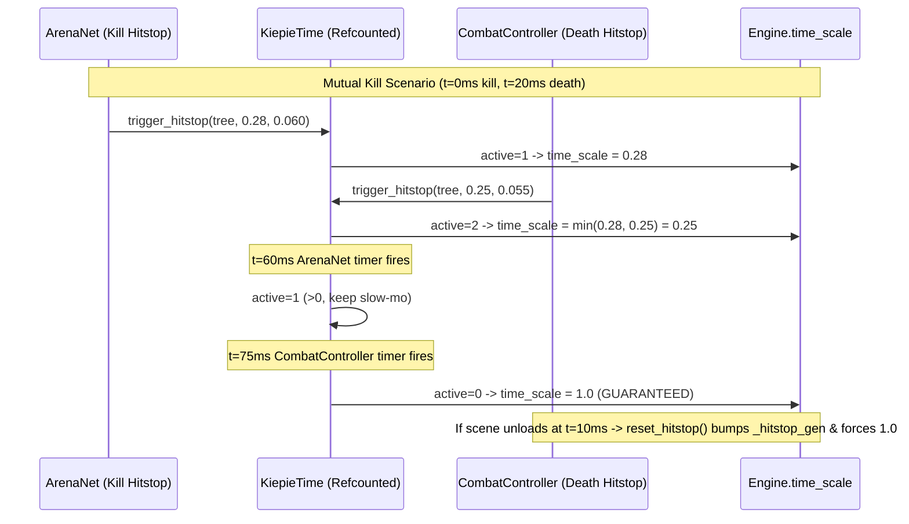
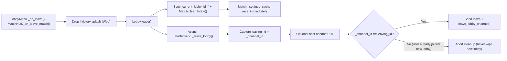
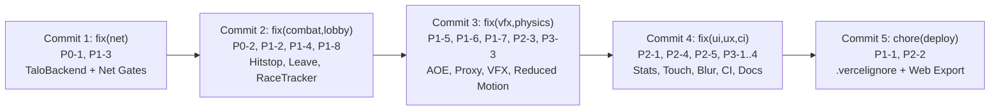

# Kiepie Quad Surgical Audit Remediation — Implementation Plan (Enhanced)

> **Agent:** Antigravity (Coordinator)
> **Enhanced sub-skills invoked:** `writing-plans-enhanced` + `surgical-audit` (Pass 4.5 Remediation Delivery) + `surgical-implementation`
> **Verification mode:** Test (27/27 Godot headless + xvfb + GdUnit4 gates) · Failing-First Regression Proof · Transform/Binary Bundle Inspection · Live Vercel Artefact Verification · Visual/Viewport Clearance Verification

**Goal:** Remediate all **19 findings** (`2 P0`, `8 P1`, `5 P2`, `4 P3`) from [kiepie-quad-surgical-audit-2026-11-20.md](file:///home/leandi-duplessis/github/3D%20builds/kiepie-quad/kiepie-quad-web/docs/audits/kiepie-quad-surgical-audit-2026-11-20.md) in a **5-commit, independently green, bisect-safe series**, raising the deterministic Health Score from **`64 / 100` (`CRITICAL`)** to **`≥ 92 / 100` (`LOW`, `0 P0`, `0 P1`, `M_kill ≥ 80%`)** and shipping the refreshed Web bundle (`298d9f4` + fixes) behind a strict `.vercelignore` allowlist.

**Architecture:** Enforce strict trust boundaries at the Talo WebSocket ingress (allowlist `"join"` rows, reject frames when `_channel_id <= 0`, separate offline test inertness via `_channel == null`), centralize global `Engine.time_scale` hitstop ownership inside a refcounted `KiepieTime` coordinator, eliminate split-brain state (`Match.clear_lobby()` + `_settings_cache`, `VehicleRegistry` ↔ `SideCannons`), fail closed on unverified Death Race laps and invisible remote AOE targets, complete `Settings.reduced_motion()` compliance across VFX/projectiles/exhaust, and lock down Vercel static hosting so only `index.*`, `favicon.ico`, and `web-assets/**` deploy.

**Anti-Gravity boundary:** Shared context is strictly repository code, scene builders, offline gates (`KIEPIE_MOCK_BACKEND=1`), and non-secret deployment topology. `.env` contents (`TALO_API_GAME`, `TALO_API_ADMIN`), local machine credentials, and live Talo account tokens are **never** printed, committed, or shared; `godot/tools/inject_talo_key.py` + `deploy_web.sh`'s backup/restore trap handle the public game JWT exclusively during the gated Web export.

---

## User Review Required

> [!IMPORTANT]
> **1. Scope of Modular Refactor (`P2-1` God Files):**
> This plan fixes the **live split-brain bug** between `VehicleRegistry.gd` and `SideCannons.gd` (single source of truth for weapon stats + single cooldown map) right away in Commit 4. It **intentionally defers** splitting `VfxFactory.gd` (1,149 LOC) and `TaloBackend.gd` (869 LOC) into sub-files to a follow-up refactor PR so Commit 1–5 diffs remain surgical, easy to audit, and zero-risk for Godot 4.3 `-s` tool-script preloading. Let me know if you want `VfxFactory.gd` split in this pass instead.

> [!WARNING]
> **2. Production Web Deploy & Live Push (`Commit 5`):**
> Commit 5 runs `bash godot/tools/deploy_web.sh --apply`, which re-exports `index.pck`/`index.html`/`index.service.worker.js`, commits them to `main`, pushes to `origin/main` (triggering Vercel Production auto-deploy), and verifies both the new bundle markers and `404` blocking of `docs/audits/*` via `curl`. Confirm if you want Commit 5 to **push & deploy live**, or stop at a local dry-run (`deploy_web.sh` without `--apply`) for manual review first.

> [!NOTE]
> **3. Protocol Compatibility (`PROTOCOL_VERSION = "2"`):**
> Every networking fix in Commit 1 (`"join"` allowlist, `_channel_id <= 0` drop, reconnect state resync, `_leave_lobby` generation guard) is **100% wire-compatible with `PROTOCOL_VERSION = "2"`** — no protocol bump is required.

---

## Architecture & Defect-Elimination Diagrams

### 1. Refcounted `Engine.time_scale` Hitstop Coordinator (`P0-2`)



### 2. Synchronous `Lobby.leave()` + `TaloBackend` Leave Isolation (`P1-2`, `P1-3`)



### 3. Five-Commit Bisect-Safe Delivery Series



---

## Proposed Changes

### Commit 1 — `fix(net): harden TaloBackend join allowlist, active-channel guard, and reconnect resync`

Resolves **`P0-1`** (untrusted `"join"` `laps`/`kills` injection & reconnect wipe) and **`P1-3`** (`_channel_id <= 0` socket bypass, rapid Leave→Create race, and reconnect state desync).

#### [MODIFY] [TaloBackend.gd](file:///home/leandi-duplessis/github/3D%20builds/kiepie-quad/kiepie-quad-web/godot/src/net/TaloBackend.gd)

1. **Reconnect State Resync (`L165-L170`):** After `Talo.socket` finishes re-identifying inside `_on_socket_closed()`, if `_channel_id > 0`, fetch fresh channel props (`await Talo.channels.find(_channel_id)`), update `_channel`, and call `_load_state()`, `_emit_state()`, and `_emit_roster()` so missed match-start / host-handoff / winner transitions converge immediately.
2. **Rapid Leave→Create Isolation (`L479-L485`):** Capture `var leaving_id := _channel_id` before `await _handoff_host_before_leave()`. If `_channel_id != leaving_id` after `await`, return without touching the newly joined channel.
3. **Offline-Safe `_send()` (`L812-L816`):** Guard `if _channel_id <= 0 or _channel == null: return` so offline tests staging `_channel_id = 1, _channel = null` can exercise the real channel-ID filter in `_on_socket_message()` without ever touching `Talo.channels.send_message()`.
4. **Strict Active-Channel Guard (`L822-L824`):**
   ```gdscript
   if _channel_id <= 0:
       return
   var ch = data.get("channel", null)
   if ch is Dictionary and int((ch as Dictionary).get("id", _channel_id)) != _channel_id:
       return
   ```
5. **Allowlist `"join"` Roster Sanitization (`L869-L889`):** Replace `var row := p.duplicate(true)` with an explicit allowlist preserving `score`, `kills`, `laps`, `is_ready`, and `respawn_at` strictly from `prev`:
   ```gdscript
   if kind == "join":
       if _roster.size() >= 8 and not _roster.has(uid):
           return
       var col := str(p.get("color", "#40c8ff"))
       if not _is_hex_color(col):
           col = "#40c8ff"
       var prev: Dictionary = (_roster[uid] as Dictionary) if (_roster.has(uid) and _roster[uid] is Dictionary) else {}
       _roster[uid] = {
           "user_id": uid,
           "display_name": str(p.get("display_name", "RIDER")).substr(0, 32),
           "color": col,
           "score": int(prev.get("score", 0)),
           "kills": int(prev.get("kills", 0)),
           "laps": int(prev.get("laps", 0)),
           "is_ready": bool(prev.get("is_ready", false)),
           "respawn_at": str(prev.get("respawn_at", "")),
       }
   ```

#### [MODIFY] [verify_talo_backend.gd](file:///home/leandi-duplessis/github/3D%20builds/kiepie-quad/kiepie-quad-web/godot/tools/verify_talo_backend.gd) & [verify_audit_regressions.gd](file:///home/leandi-duplessis/github/3D%20builds/kiepie-quad/kiepie-quad-web/godot/tools/verify_audit_regressions.gd)

- Stage `_channel_id = 1` (with `_channel = null`) in staged-memory backend fixtures so channel filtering is exercised for real.
- Add **failing-first regression tests**:
  1. Matching-alias `"join"` carrying `{"user_id": "2", "laps": 99, "kills": 99, "score": 99, "is_ready": true}` -> assert host `_roster["2"]` has `laps == 0`, `kills == 0`, `score == 0`, `is_ready == false`.
  2. Existing peer `"2"` with `laps = 2, kills = 3, score = 2` sends `"join"` omitting `laps`/`kills` -> assert `laps == 2`, `kills == 3`, `score == 2` are preserved.
  3. After `leave_lobby_channel()` (`_channel_id == -1`), incoming `"join"` and `"bike_state"` frames are dropped (`_roster.is_empty()` and 0 signals emitted).

#### Verify Visual & Transform Claims (Commit 1)
- [ ] **Transform claim:** `TaloBackend._on_socket_message` drops all payloads when `_channel_id <= 0` and strips non-allowlisted keys (`laps`, `kills`, `score`, `is_ready`, `respawn_at`) on `"join"`.
- [ ] **Failing-first proof:** Run new assertions against unpatched `TaloBackend.gd` first and observe explicit `FAIL` (`laps == 99`, `_roster` mutated at `_channel_id == -1`), then apply fix and re-run green.
- [ ] **Verification method:** `godot-4.3 --headless --path godot --script tools/verify_talo_backend.gd`, `verify_audit_regressions.gd`, `verify_multiplayer.gd`, then `bash godot/tools/run_gates.sh --no-build`.

---

### Commit 2 — `fix(combat,lobby): refcounted hitstop coordinator, fail-closed RaceTracker, and sync Lobby.leave()`

Resolves **`P0-2`** (permanent slow-mo lock on overlapping hitstops + scene exit), **`P1-2`** (`Lobby.leave()` race + stale `Match._settings_cache`), **`P1-4`** (`RaceTracker` fail-open lap credit), **`P1-8`** (`MatchState` per-call `_settings_cache` deep-dup + `time_up` race), **`P2-3a`** (`take_damage` `<= 0`/`NaN` guard), and **`P2-5a`** (`ArenaNet` peer-map pruning + `MatchHud._name_for` $O(1)$ lookup & cached `show_fps`).

#### [MODIFY] [KiepieTime.gd](file:///home/leandi-duplessis/github/3D%20builds/kiepie-quad/kiepie-quad-web/godot/src/core/KiepieTime.gd)

- Add static refcounted hitstop coordinator (`_hitstop_active`, `_hitstop_gen`, `trigger_hitstop(tree, scale, duration_s)`, `reset_hitstop()`):
  - Always restores `Engine.time_scale = 1.0` when `_hitstop_active` reaches `0`.
  - Bumping `_hitstop_gen` in `reset_hitstop()` invalidates any pending `SceneTreeTimer` callbacks on scene unload so they cannot clobber `Engine.time_scale` in the next scene.

#### [MODIFY] [CombatController.gd](file:///home/leandi-duplessis/github/3D%20builds/kiepie-quad/kiepie-quad-web/godot/src/game/CombatController.gd) & [ArenaNet.gd](file:///home/leandi-duplessis/github/3D%20builds/kiepie-quad/kiepie-quad-web/godot/src/game/ArenaNet.gd)

- Preload `KiepieTime.gd` in both scripts; replace raw `Engine.time_scale` save/restore in `CombatController._die()` (`L204-L212`) and `ArenaNet._do_hitstop()` (`L193-L203`) with `KT.trigger_hitstop(get_tree(), ...)`.
- Call `KT.reset_hitstop()` in both `CombatController._exit_tree()` (`L146-L151`) and `ArenaNet._exit_tree()` (`L73-L77`).
- Guard `CombatController.take_damage()` (`L154-L165`) with `if not is_finite(amount) or amount <= 0.0: return`.
- In `ArenaNet._sync_roster()` (`L348-L353`), erase departed peer `id` from `_shot_log`, `_rocket_last`, `_meteor_last`, `_death_gen`, and `_local_dmg_shown_at`.
- In `ArenaNet._send_state()` (`L100`), use `Quaternion(bike.global_transform.basis.orthonormalized())`.

#### [MODIFY] [MatchState.gd](file:///home/leandi-duplessis/github/3D%20builds/kiepie-quad/kiepie-quad-web/godot/src/net/MatchState.gd), [LobbyService.gd](file:///home/leandi-duplessis/github/3D%20builds/kiepie-quad/kiepie-quad-web/godot/src/net/LobbyService.gd), [LobbyMenu.gd](file:///home/leandi-duplessis/github/3D%20builds/kiepie-quad/kiepie-quad-web/godot/src/ui/LobbyMenu.gd), [MatchHud.gd](file:///home/leandi-duplessis/github/3D%20builds/kiepie-quad/kiepie-quad-web/godot/src/ui/MatchHud.gd)

- `MatchState.gd`:
  - Add `clear_lobby()` clearing `lobby`, `players`, `_time_up_called`, refreshing `_settings_cache`, and emitting `lobby_changed` + `roster_changed`.
  - Switch `kill_target()`, `game_mode()`, `lap_target()`, `max_players()`, `respawn_delay()`, `damage()`, and `pickups_enabled()` (`L118-L145`) from `settings().get(...)` to direct `_settings_cache.get(...)`.
  - In `_process()` (`L53-L70`), capture `var expected_id := str(lobby.get("id", ""))` before `await Supabase.call_rpc("time_up", {})` and abort if `str(lobby.get("id", "")) != expected_id`.
- `LobbyService.gd`: Clear `current_lobby_id = ""` and call `Match.clear_lobby()` **synchronously** at the start of `leave()` before awaiting `leave_lobby`, so rapid Leave→Create never sees stale `Match.lobby` or stale `_settings_cache`.
- `LobbyMenu.gd`: Clamp all `OptionButton.selected` array indices (`L345-L349`) with `clampi(..., 0, arr.size() - 1)` (`P3-2a`); prevent double `leave()` from `_on_left_elsewhere()`.
- `MatchHud.gd`:
  - In `_on_leave_match()`, dismiss `#victory-splash` on Web (`window.__kiepieDropVictory && window.__kiepieDropVictory()`).
  - Replace `_name_for()` (`L641-L648`) $O(N \log N)$ `Match.scoreboard()` sort with $O(1)$ `Match.players.get(uid)` lookup.
  - Cache `_show_fps` in `_ready()` and update via `Settings.changed` (disconnected in `_exit_tree()`) instead of querying `Settings.get_value()` at 60 Hz.

#### [MODIFY] [RaceTracker.gd](file:///home/leandi-duplessis/github/3D%20builds/kiepie-quad/kiepie-quad-web/godot/src/game/RaceTracker.gd)

- In `_on_finish_line_entered()` (`L121-L137`), fail closed whenever `was_live_match`:
  ```gdscript
  if was_live_match:
      var shot_res: Dictionary = await Match.issue_shot()
      if not is_inside_tree():
          _finishing_lap = false
          return
      var tok := str(shot_res.get("token", ""))
      if tok == "":
          _finishing_lap = false
          return
      var lap_res: Dictionary = await Match.register_lap(tok)
      if not is_inside_tree():
          _finishing_lap = false
          return
      if not bool(lap_res.get("ok", false)):
          _finishing_lap = false
          return
      lap_pending = bool(lap_res.get("pending", false))
  ```

#### [MODIFY] [verify_combat.gd](file:///home/leandi-duplessis/github/3D%20builds/kiepie-quad/kiepie-quad-web/godot/tools/verify_combat.gd), [verify_match_rules.gd](file:///home/leandi-duplessis/github/3D%20builds/kiepie-quad/kiepie-quad-web/godot/tools/verify_match_rules.gd), [verify_deathrace.gd](file:///home/leandi-duplessis/github/3D%20builds/kiepie-quad/kiepie-quad-web/godot/tools/verify_deathrace.gd)

- Add failing-first assertions for:
  1. Overlapping `ArenaNet._do_hitstop()` + `CombatController._die()` restores `Engine.time_scale == 1.0` after `120 ms` (and freeing `CombatController` mid-hitstop immediately restores `1.0`).
  2. `take_damage(-50.0, ...)` and `take_damage(NAN, ...)` leave `health` finite and unchanged.
  3. `Lobby.leave()` immediately empties `Match.lobby` AND resets `Match.game_mode() == "battle_royale"` / `Match.damage() == 30.0`.
  4. `RaceTracker` does not increment `completed_laps` when `register_lap` fails with `{}` or `not_in_lobby`.

#### Verify Visual & Transform Claims (Commit 2)
- [ ] **Transform claim:** `Engine.time_scale` never sticks below `1.0` after overlapping hitstops or scene unloads; `Match._settings_cache` resets immediately on `Lobby.leave()`; `RaceTracker` fails closed on failed RPCs.
- [ ] **Visual claim:** Leaving a Death Race victory screen via `Esc` or `LeaveBtn` dismisses the HTML `#victory-splash` overlay cleanly.
- [ ] **Verification method:** Failing-first proof on `verify_combat.gd`, `verify_match_rules.gd`, `verify_deathrace.gd`, then `bash godot/tools/run_gates.sh --no-build`.

---

### Commit 3 — `fix(vfx,physics): guard AOE ghost hits, NetworkedBike collider, VfxFactory lifecycle & reduced-motion`

Resolves **`P1-5`** (AOE ghost hits on invisible dead proxies), **`P1-6`** (`VfxFactory` pre-tree `global_transform`, reduced-motion Wilson/smash rings & projectile trails/exhaust, uncapped `Label3D` + outline fade, orphan `casing`), **`P1-7`** (`NetworkedBike` invisible `(0,0,0)` collider), **`P2-3b`** (`vfx_light` removal on projectile/meteor free + mushroom AABB), **`P3-2b`** (dead `_light`/`_glow`), and **`P3-3`** (chained `FuelDrum` token suffix).

#### [MODIFY] [VfxFactory.gd](file:///home/leandi-duplessis/github/3D%20builds/kiepie-quad/kiepie-quad-web/godot/src/game/VfxFactory.gd)

1. Add `const MAX_DAMAGE_NUMBERS := 18`.
2. In `_particle()` (`L438`), support optional `opts.get("aabb", AABB(Vector3(-8, -6, -8), Vector3(16, 16, 16)))` and pass a tall `AABB(Vector3(-18, -6, -18), Vector3(36, 48, 36))` for `mushroom` stem & cap emitters.
3. In `casing()` (`L681-L682`), call `body.queue_free()` when `tree == null` so the body is never leaked.
4. In `particle_explosion(..., mushroom=true)` (`L931-L936`), wrap the Wilson condensation ring in `if not reduced:`.
5. In `_build_death_wreck()` (`L1062`) & `dramatic_death_explosion()` (`L1148-L1149`), set `wreck.transform = Transform3D(...)` (or set `wreck.global_transform` *after* `parent.add_child(wreck)`), and scale `plume.amount` by `maxi(4, int(26 * _q()))`.
6. In `smash_burst()` (`L1260-L1263`), replace the animated `_ring_quad(..., 4.0, 0.7, true)` under `reduced_motion()` with `_static_cue(...)`.
7. In `damage_number()` (`L1316-L1341`), add `label.add_to_group("vfx_dmg_num")`, call `_cap_group(parent, "vfx_dmg_num", MAX_DAMAGE_NUMBERS)` after `add_child`, remove from group before `queue_free()`, and parallel-tween `label, "outline_modulate:a", 0.0, 0.75`.

#### [MODIFY] [RocketProjectile.gd](file:///home/leandi-duplessis/github/3D%20builds/kiepie-quad/kiepie-quad-web/godot/src/game/RocketProjectile.gd), [MeteorStrike.gd](file:///home/leandi-duplessis/github/3D%20builds/kiepie-quad/kiepie-quad-web/godot/src/game/MeteorStrike.gd), [FuelDrum.gd](file:///home/leandi-duplessis/github/3D%20builds/kiepie-quad/kiepie-quad-web/godot/src/game/FuelDrum.gd)

- Skip `not bike_node.visible or bool(bike_node.get("is_respawning"))` in all three AOE bike loops.
- Add `_release_light()` (removing `_light` from `"vfx_light"` before `queue_free()`) called in `_detonate()` and `_exit_tree()` of `RocketProjectile.gd` and `MeteorStrike.gd`.
- Guard rocket/meteor particle trails, spin, and warning-ring pulse with `if not Settings.reduced_motion():`.
- In `FuelDrum.gd:L123`, pass `"%s:c%d" % [token, target.get_instance_id()]` (when `token != ""`) to chained drums so chain multi-kills aren't dropped by `token_consumed`.

#### [MODIFY] [NetworkedBike.gd](file:///home/leandi-duplessis/github/3D%20builds/kiepie-quad/kiepie-quad-web/godot/src/game/NetworkedBike.gd), [Projectile.gd](file:///home/leandi-duplessis/github/3D%20builds/kiepie-quad/kiepie-quad-web/godot/src/game/Projectile.gd), [BananaProjectile.gd](file:///home/leandi-duplessis/github/3D%20builds/kiepie-quad/kiepie-quad-web/godot/src/game/BananaProjectile.gd), [KiepieBike.gd](file:///home/leandi-duplessis/github/3D%20builds/kiepie-quad/kiepie-quad-web/godot/src/KiepieBike.gd), [Pickup.gd](file:///home/leandi-duplessis/github/3D%20builds/kiepie-quad/kiepie-quad-web/godot/src/game/Pickup.gd)

- `NetworkedBike.gd`: Initialize `collision_layer = 0` in `setup()` (`L40`); in `apply_state()` first-packet branch (`L134-L140`), set `collision_layer = 0 if dead_now else 1`.
- `Projectile.gd` & `BananaProjectile.gd`: Remove dead `var _light` field & per-tick check; guard `_trail` emission & banana tumble spin with `not Settings.reduced_motion()`.
- `KiepieBike.gd`: Scale `_flames.amount` by `maxi(8, int(72 * Settings.quality_multiplier()))`, suppress `_flames.emitting` & `_jet_plume` pulse under `Settings.reduced_motion()`, and hide `_jet_plume` in `reset_bike()`.
- `Pickup.gd`: Remove dead `var _glow` field & checks; disconnect `Match.lobby_changed` in `_exit_tree()`.

#### [MODIFY] [verify_vfx.gd](file:///home/leandi-duplessis/github/3D%20builds/kiepie-quad/kiepie-quad-web/godot/tools/verify_vfx.gd), [verify_multiplayer.gd](file:///home/leandi-duplessis/github/3D%20builds/kiepie-quad/kiepie-quad-web/godot/tools/verify_multiplayer.gd), [verify_deathrace.gd](file:///home/leandi-duplessis/github/3D%20builds/kiepie-quad/kiepie-quad-web/godot/tools/verify_deathrace.gd), [verify_controls.gd](file:///home/leandi-duplessis/github/3D%20builds/kiepie-quad/kiepie-quad-web/godot/tools/verify_controls.gd)

- `verify_vfx.gd`: Isolate `mushroom_cloud_explosion` onto its own **empty** `holder` (killing the shared-holder M3 blind spot), assert cap/stem emitters spawn under normal mode AND `0` particles / `0` Wilson ring under `reduced_motion = true`, and assert `damage_number` caps at `MAX_DAMAGE_NUMBERS = 18` with `outline_modulate.a` tweened.
- `verify_multiplayer.gd`: Assert `rb2.collision_layer == 0` before first `"state"` packet and `== 1` after live `"state"` packet (and `== 0` if initial state has `d: true`).
- `verify_deathrace.gd`: Update stale `5s CD` header comment; add invisible `dummy_proxy.visible = false` inside Rocket & Meteor blast radii and assert `0` ghost `Label3D` damage numbers spawn.
- `verify_controls.gd`: Add a live reverse-driving physics check (`Input.action_press("move_back")` from rest for 60 frames -> assert `z < -4.0 m`).

#### Verify Visual & Transform Claims (Commit 3)
- [ ] **Visual claim:** Under `Reduced Motion = ON`, meteor impacts, building collapses, projectiles, and turbo produce zero animated rings/trails/flames; damage numbers fade cleanly without dark outline ghosts.
- [ ] **Transform claim:** `NetworkedBike.collision_layer == 0` while uninitialized or dead; `dramatic_death_explosion` produces zero `!is_inside_tree()` errors; `KiepieBike` reverses `> 4.0 m` in 1 s.
- [ ] **Verification method:** Failing-first proof on `verify_vfx.gd`, `verify_multiplayer.gd`, `verify_deathrace.gd`, `verify_controls.gd`, then `bash godot/tools/run_gates.sh --no-build`.

---

### Commit 4 — `fix(ui,ux,ci): unify VehicleRegistry stats, desktop touch clearance, MobileTextInput blur, Settings reset & CI pinning`

Resolves **`P2-1`** (`VehicleRegistry` ↔ `SideCannons` split-brain), **`P2-4`** (desktop touch overlap, `MobileTextInput` `blur()`, OS `prefers-reduced-motion`), **`P2-5b`** (`SideCannons` `_process` raycast, `SettingsMenu` debounce overwrite, `PogoVisual` cached `Settings`), **`P3-1`** (CI pinning & Godot SHA-256), **`P3-2`** (duplicate resets), and **`P3-4`** (`MainMenu._exit_tree` + `FollowCam` kill-cam guard & child-camera shake).

#### [MODIFY] [SideCannons.gd](file:///home/leandi-duplessis/github/3D%20builds/kiepie-quad/kiepie-quad-web/godot/src/game/SideCannons.gd)

- Derive `PROFILES` values from `VehicleRegistry.cooldown()`, `rapid_cooldown()`, `damage_multiplier()`, `spread()`, and `fire_sfx()` via a static helper `_profile_for(profile_id)` so `SideCannons` and `ArenaNet` cannot diverge.
- Make `_cooldown` a clean getter/setter forwarding to `_cooldowns[current_weapon]` (eliminating the bidirectional `_process()` sync hack).
- In `_update_aim_reticle()`, when `not _has_cached_meteor`, hide the reticle until the next `_physics_process()` tick populates `_cached_meteor_target` (never calling `direct_space_state.intersect_ray()` from `_process()` / `_unhandled_key_input()`).

#### [MODIFY] [TouchControls.gd](file:///home/leandi-duplessis/github/3D%20builds/kiepie-quad/kiepie-quad-web/godot/src/TouchControls.gd), [MobileTextInput.gd](file:///home/leandi-duplessis/github/3D%20builds/kiepie-quad/kiepie-quad-web/godot/src/ui/MobileTextInput.gd), [Settings.gd](file:///home/leandi-duplessis/github/3D%20builds/kiepie-quad/kiepie-quad-web/godot/src/core/Settings.gd), [SettingsMenu.gd](file:///home/leandi-duplessis/github/3D%20builds/kiepie-quad/kiepie-quad-web/godot/src/ui/SettingsMenu.gd)

- `TouchControls.gd`: In `_relayout()` Standard desktop branch (`vp.x >= 720.0 and vp.y >= 520.0`), keep `AnalogSteer` at `offset_bottom = -56.0` (`offset_top = -196.0`) so toggling `TOUCH: ON` on desktop clears `index.html`'s bottom hint strip (`bottom: 16px`). Remove duplicate `_analog_turbo = false; _analog_reverse = false` lines in `_release_all()`.
- `MobileTextInput.gd`: Inside JS `removeField()` (`L419-L422`), call `try { input.blur(); } catch (_) {}` before hiding `overlay`.
- `Settings.gd`: In `_load()` (`L302-L304`), when no existing `settings.cfg` is found on Web (`OS.has_feature("web") and Engine.has_singleton("JavaScriptBridge")`), seed `data["gameplay"]["reduced_motion"]` from `window.matchMedia('(prefers-reduced-motion: reduce)').matches` (leaves headless/desktop tests and existing saved configs 100% untouched).
- `SettingsMenu.gd`: In `_on_defaults()` (`L243-L245`), clear `_pending_writes.clear()` and stop `_flush_timer` before `Settings.reset_defaults()`.

#### [MODIFY] [MainMenu.gd](file:///home/leandi-duplessis/github/3D%20builds/kiepie-quad/kiepie-quad-web/godot/src/ui/MainMenu.gd), [FollowCam.gd](file:///home/leandi-duplessis/github/3D%20builds/kiepie-quad/kiepie-quad-web/godot/src/FollowCam.gd), [PogoVisual.gd](file:///home/leandi-duplessis/github/3D%20builds/kiepie-quad/kiepie-quad-web/godot/src/game/PogoVisual.gd)

- `MainMenu.gd`: Add `_exit_tree()` disconnecting `Supabase.auth_status`, `Lobby.error_message`, `Match.error_message`, and `get_viewport().size_changed`.
- `FollowCam.gd`: Extract `_safe_look_at(look_target, up_vec)` and use it in both follow and kill-cam modes; apply screen shake to child `_cam.position` (resetting to `Vector3.ZERO` when `_shake <= 0.001`) so shake never drifts the follow `lerp`.
- `PogoVisual.gd`: Cache `_settings := get_node_or_null("/root/Settings")` once in `_ready()` instead of calling `get_node_or_null` at 60 Hz.

#### [MODIFY] [verify_accessibility.gd](file:///home/leandi-duplessis/github/3D%20builds/kiepie-quad/kiepie-quad-web/godot/tools/verify_accessibility.gd), [gates.yml](file:///home/leandi-duplessis/github/3D%20builds/kiepie-quad/kiepie-quad-web/.github/workflows/gates.yml), [task-status.md](file:///home/leandi-duplessis/github/3D%20builds/kiepie-quad/kiepie-quad-web/docs/task-status.md), [AGENTS.md](file:///home/leandi-duplessis/github/3D%20builds/kiepie-quad/kiepie-quad-web/AGENTS.md)

- `verify_accessibility.gd`: Add a live-tree check verifying runtime-created `AnalogSteer` / `AnalogDrive` have `focus_mode == Control.FOCUS_NONE` (fixing the vacuous `if pad != null:` guard) and that `AnalogSteer` clears the desktop `bottom: 16px` hint band (`offset_bottom <= -52.0` at `1280×720`).
- `.github/workflows/gates.yml`: Pin `actions/checkout` to its full 40-char SHA, verify the official SHA-256 of `Godot_v4.3-stable_linux.x86_64.zip` before `unzip`, and update the step title from `25 total` to `27 total`.
- Sync `docs/task-status.md` (adding the 2026-11-20 Audit Remediation ledger) and `AGENTS.md` (updating `index.pck` size note from `~2.7 MB` to `~3.4 MB`).

#### Verify Visual & Transform Claims (Commit 4)
- [ ] **Visual claim:** On `1280×720` desktop with `TOUCH: ON`, `AnalogSteer` sits cleanly above `bottom: 56px` with zero overlap against the `"KIEPIE QUAD · W / ↑ drive..."` CSS hint strip.
- [ ] **Transform claim:** `SideCannons` reads weapon stats from `VehicleRegistry`; `SettingsMenu._on_defaults()` clears `_pending_writes`; `gates.yml` enforces SHA-256 verification on Godot 4.3 download.
- [ ] **Verification method:** `bash godot/tools/run_gates.sh` (full rebuild + `scene_sync` + all 27 gates including xvfb `touch_multitouch` and GdUnit4).

---

### Commit 5 — `chore(deploy): add .vercelignore allowlist and refresh live Web bundle`

Resolves **`P1-1`** (stale shipped `index.pck`) and **`P2-2`** (Vercel root exposing source, 40 MB of PNG renders, `.blend`/`.stl`, and `docs/audits/*`).

#### [NEW] [.vercelignore](file:///home/leandi-duplessis/github/3D%20builds/kiepie-quad/kiepie-quad-web/.vercelignore)

```gitignore
# Allowlist ONLY the Vercel-served Web build at repo root + web-assets/.
# Prevents deploying 40+ MB of PNG renders, .blend/.stl sources, GDScript/Python,
# and internal docs/audits/ reports to public static hosting.
*
!/index.html
!/index.js
!/index.wasm
!/index.pck
!/index.manifest.json
!/index.service.worker.js
!/index.audio.worklet.js
!/index.offline.html
!/index.png
!/index.144x144.png
!/index.180x180.png
!/index.512x512.png
!/favicon.ico
!/web-assets
!/web-assets/**
```

#### [MODIFY] Web Export Bundle (`index.pck`, `index.html`, `index.service.worker.js`, `index.*`)

- Run `bash godot/tools/deploy_web.sh --apply` (or dry-run first if user chooses local review):
  1. Executes all 27 gates + `scene_sync`.
  2. Injects `TALO_API_GAME` temporarily via `inject_talo_key.py` (restored via `trap cleanup EXIT`).
  3. Exports Godot 4.3 Web release to git-ignored `web/`, enforces `index.pck <= 4 MB`, patches `index.service.worker.js` via `patch_web_sw.py`.
  4. Syncs `web/*` -> repo root, commits `index.*` with `--only`, pushes `main`, and waits for Vercel Production alias hash parity.

#### Verify Visual & Transform Claims (Commit 5)
- [ ] **Transform claim (Sandbox `.vercelignore` simulation):** Simulate `.vercelignore` over `git archive HEAD` and verify the exact uploaded file list contains ONLY the 13 `index.*`/`favicon.ico` files + 3 `web-assets/*` files (`0` `.gd`, `0` `.py`, `0` `docs/audits/*`, `0` `renders/*`).
- [ ] **Transform claim (Bundle symbol verification):** Confirm root `index.pck` contains `mushroom_cloud_explosion`, `dramatic_death_explosion`, `note_local_damage_shown`, `ButtCheekRed`, `MankiniPink`, and `trigger_hitstop`.
- [ ] **Deployed artefact verification (when `--apply` approved):**
  1. `curl -sI https://kiepie-quad-web.vercel.app/docs/audits/kiepie-quad-surgical-audit-2026-11-20.md` -> **`404`** (confirming audit reports & source are no longer exposed).
  2. `curl -s https://kiepie-quad-web.vercel.app/index.service.worker.js` -> matches local `md5sum` and new `pck` content hash.
  3. `curl -s https://kiepie-quad-web.vercel.app/index.pck` -> matches local `md5sum` and contains `mushroom_cloud_explosion` + `MankiniPink`.

---

## Verification Plan

### Automated Tests & Bisect-Safe Commit Verification
1. **Failing-First Proof (per Commit 1–4):** For each P0/P1 regression test, run it against pre-fix code (via scratch backup/revert per `remediation-delivery.md`), capture the exact `FAIL` output, then restore the fix and confirm `PASS`.
2. **Full Gate Suite (27/27):**
   ```bash
   bash godot/tools/run_gates.sh
   ```
   Verifies scene rebuilds, `scene_sync`, all 25 headless gates (`truth`, `stability`, `touch`, `features`, `smash_impact`, `diag2`, `cannons`, `settings`, `match_rules`, `combat`, `kill_flow`, `appeal`, `accessibility`, `talo_backend`, `audit_regressions`, `controls`, `dodge`, `rollover`, `vfx`, `practice`, `multiplayer`, `pogo`, `deathrace`, `check_scripts`), `touch_multitouch` under `xvfb-run`, and GdUnit4.
3. **Independent Per-Commit Green Proof (`git archive`):** Run `godot/tools/run_gates.sh --no-build` against an archived checkout of each commit SHA in the series so every commit is proven independently green for `git bisect`.
4. **Post-Remediation Health Score Re-Run:** Re-run `preflight_telemetry.py` and re-score `$M_{\text{kill}}$` and `$S_{\text{health}}$` to prove `0 P0`, `0 P1`, `M_kill ≥ 80%`, and `S_health ≥ 92 / 100 (LOW)`.

### Manual Verification (Post-Deploy Browser Check)
1. Open `https://kiepie-quad-web.vercel.app/` on desktop (`1280×720`):
   - Toggle `TOUCH: ON` and confirm `AnalogSteer` sits cleanly above the `"KIEPIE QUAD · W / ↑ drive..."` bottom hint strip.
   - Enter Death Race Practice: verify Borat-mankini Nardus, reverse speed, 1.5 s Rocket reload, Meteor mushroom cloud, and `Reduced Motion` toggle suppressing Wilson ring / projectile trails / exhaust flames.
2. Open two browser tabs in a private lobby:
   - Verify cross-player floating damage numbers (`"hurt"`), no invisible `(0,0,0)` collider on lobby join, and clean `Leave -> Create Lobby` transition without landing in the old room.
